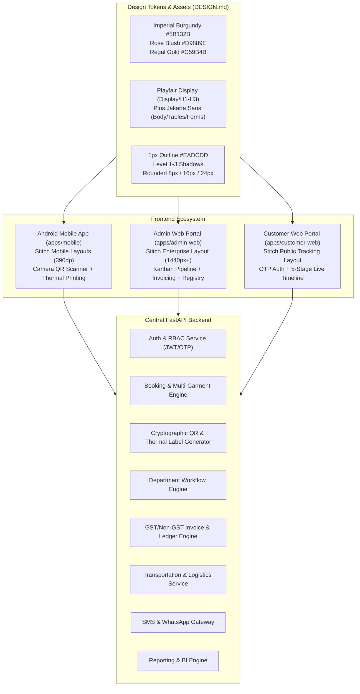

# AASHIMA ERP – Design Audit & Implementation Blueprint
**Visual Source of Truth**: Google Stitch Regal Atelier ERP Design System  
**Business**: AASHIMA Women's World & AASHIMA Stitchers 'N' Drapers  
**Location**: 581, Turab Nagar, Ghaziabad, Uttar Pradesh, India  
**Audit Date**: November 2026  

---

## 1. Executive Summary & Design System Foundations

The AASHIMA ERP visual identity and UI design language is derived from the **Regal Atelier ERP** Google Stitch export. It embodies an **haute-couture neoclassical editorial utility** tailored specifically for bespoke Indian bridal ateliers, high-end karigari workshops, and premium garment care facilities.

### 1.1 Color Tokens & Semantic Architecture
The palette pairs imperial regal tones with workshop ergonomic contrast:

| Token Name | Hex Code | Visual Application |
|---|---|---|
| **Primary** | `#5B132B` / `#3D0017` | Imperial Deep Burgundy – App bars, main CTAs, headers, brand emblems |
| **Primary Container** | `#5B132B` / `#721C39` | High-priority active navigation items, primary badges |
| **On-Primary** | `#FFFFFF` | Text on burgundy buttons, top app headers |
| **Secondary** | `#D9889E` / `#8E495D` | Rose Blush & Cashmere – Stage chips, progress accents, subtle dividers |
| **Secondary Container** | `#FFA9BF` / `#F5E6EB` | Highlight pill backgrounds, counter cards |
| **Tertiary** | `#C59B4B` / `#261800` | Muted Regal Gold – VIP patron tags, delivery deadlines, artisan badges |
| **Tertiary Fixed / Container** | `#FFDEA7` / `#BA9142` | Gold accents, highlight tags, trial-ready badges |
| **Neutral Canvas / Surface** | `#FFF8F8` / `#FAF7F5` | Soft ivory atelier background |
| **Card Surface** | `#FFFFFF` | Pure white container cards, ledger panels, modal drawers |
| **Surface Low / High** | `#FDF0F3` / `#F2E5E8` | Input fills, nested item containers, table rows |
| **On-Surface** | `#201A1C` | Rich ink charcoal for maximum legibility of metrics |
| **On-Surface Variant** | `#544245` | Secondary metadata, dates, labels |
| **Structural Outline** | `#EADCDD` / `#867275` | 1px delicate rose-tinted card and table borders |
| **Success** | `#1E7B4D` | Forest Emerald – Delivered status, fully paid indicators, QC passed |
| **Warning** | `#C87D12` | Warm Amber – Impending trial dates, fabric hold notices |
| **Error** | `#BA1A1A` / `#BA2D3A` | Muted Carmine – Overdue flags, payment shortfalls, cancellations |

### 1.2 Typography Hierarchy
- **Brand & Display Headers**: `Playfair Display` (font weights: 600, 700) – Screen titles, boutique headers, Rupee financial totals (`₹`).
- **Interface & Operational Text**: `Plus Jakarta Sans` (font weights: 400, 600, 700) – Numeric measurements, tables, form inputs, buttons.
- **Financial Standard**: Tabular numerals (`tnum`) for Rupee (`₹`) amounts across all ledgers, invoices, and thermal receipts.
- **Measurements**: Dual bold formatting (e.g. `38.5"` with `in` suffix) preventing workshop error.

---

## 2. Inventory of Exported Google Stitch Screens

The workspace contains 6 complete Stitch design exports with HTML/CSS and PNG renders:

| # | Screen Directory | Shell Type | Resolution / Target | Core Components & Features |
|---|---|---|---|---|
| 1 | `aashima_admin_web_portal_enterprise_atelier_management` | `web_dashboard` | Desktop / Tablet (1440px+) | Atelier sidebar, 4 stat cards (Daybook, Pipeline, Critical Alerts, Counter balance), Quick Action Toolbar, Active Production Orders table, Thermal print preview drawer |
| 2 | `aashima_atelier_dashboard` | `mobile_app` | Android (390x844dp) | Header with Turab Nagar branding, Shift status, 4 metric cards, 5-icon Counter Shortcuts, Urgent Attention orders, Live Workshop Wings, Bottom navigation |
| 3 | `new_garment_tailoring_booking` | `mobile_app` | Android (390x844dp) | Customer Patron Summary, Multi-Division Selector (Women's World vs Stitchers 'N' Drapers), Multi-Article Garment Cards, Service checkboxes, Advance payment calculator, Delivery date picker |
| 4 | `tailoring_measurement_matrix` | `mobile_app` | Android (390x844dp) | Segment tabs (Coat, Pant, Shirt, Kurta/Pajama, Lehenga/Blouse), Inch/CM toggle, 0.25" increment steppers, 10 key anchor measurements, Karigar special directives, Past fitting history loader |
| 5 | `garment_qr_tracking_stage_update` | `mobile_app` | Android (390x844dp) | Scanned QR identifier banner (100% Match), Garment Dossier with customer details & quick call/WhatsApp, Stage transition pills, Staff selector, Karigar notes, Camera proof capture, Complete Stage Transition button |
| 6 | `garment_order_live_tracking_aashima_public_portal` | `customer_web` | Responsive Mobile / Desktop | Live 5-stage tracking progress with active pulsing node, Intake inspection visual proof & karigar directives, Itemized garment bill breakdown, Download tax invoice CTA, Assistance contact |

---

## 3. Screen Inventory & Missing Screens Analysis

To deliver a **complete, production-ready enterprise ERP**, the existing Stitch designs provide the exact visual reference for core flows. Additional application views must be synthesized using the **identical Regal Atelier design tokens, CSS classes, typography, and component hierarchy**:

### 3.1 Android Application (`apps/mobile`)
1. **Splash & Login**: *Synthesized* – Brand emblem `#5B132B`, Playfair Display title, staff credentials/PIN input, biometric login prompt.
2. **Dashboard**: *Available in Stitch* (`aashima_atelier_dashboard`).
3. **Customer Management & Registry**: *Synthesized* from Stitch admin registry – customer search, patron tier badges (Gold/Silver), past orders list, direct call/WhatsApp triggers.
4. **New Booking**: *Available in Stitch* (`new_garment_tailoring_booking`) – multi-garment, division selection, article details.
5. **Garment Management & Inspection**: *Synthesized* – garment photo capture, fabric condition notes, barcode tag assignment.
6. **Tailoring Measurement Matrix**: *Available in Stitch* (`tailoring_measurement_matrix`) – Coat, Pant, Shirt, Kurta, Lehenga, Blouse, 0.25" steppers, Inch/CM toggle.
7. **Order Management & Timeline**: *Synthesized* – order search, status filter, multi-garment status overview.
8. **QR Scanner**: *Available in Stitch* (`garment_qr_tracking_stage_update`) – integrated camera viewfinder, torch toggle, manual QR token fallback.
9. **Garment Status & Department Update**: *Available in Stitch* (`garment_qr_tracking_stage_update`).
10. **Department Work Queues**: *Synthesized* – Alteration queue, Deep Cleaning queue, Finishing queue, Delivery Centre queue.
11. **Payments & Ledger**: *Synthesized* – Cash, UPI, Card entry, partial payment recording, outstanding balance updates.
12. **Invoices & Receipts**: *Synthesized* – GST & Non-GST generation, thermal slip trigger.
13. **Printing Module**: *Synthesized* from Stitch thermal drawer – 58mm & 80mm Bluetooth ESC/POS and A4 printer triggers.
14. **Delivery Management**: *Synthesized* – Out for delivery dispatch, delivery personnel assignment, proof of delivery.
15. **Reports**: *Synthesized* – Daybook summary, shift closing, revenue breakdown.
16. **Notifications**: *Synthesized* – WhatsApp/SMS notification status logs.
17. **Settings**: *Synthesized* – Shop details, Bluetooth printer pairing, staff role switches.

### 3.2 Admin Web Dashboard (`apps/admin-web`)
1. **Overview Dashboard**: *Available in Stitch* (`aashima_admin_web_portal_enterprise_atelier_management`).
2. **Karkhana Live Pipeline**: *Synthesized* from Stitch pipeline bar – Interactive Kanban board with columns: Intake, Alteration, Deep Clean, Finishing, Delivery Centre, Ready, Out for Delivery, Delivered.
3. **Customer Registry & Ledger**: *Available in Stitch* navigation – full customer data table, lifetime spend, dues, fitting history.
4. **Tailoring Measurement Book**: *Available in Stitch* navigation – searchable customer measurement archives, baseline comparisons.
5. **GST Invoicing & Financial Ledger**: *Available in Stitch* navigation – CGST, SGST, IGST calculations, HSN codes, invoice PDF download.
6. **QR & Thermal Printing Center**: *Available in Stitch* navigation – single tag generation, bulk sheet print (58mm, 80mm, A4 sticky labels).
7. **Expense Management**: *Synthesized* – workshop expenses (materials, threads, packaging, logistics, utility).
8. **Staff Management & Roles**: *Synthesized* – staff creation, role assignment (Owner, Manager, Staff, Accountant, Delivery Staff), audit log monitor.
9. **Reports & Analytics**: *Synthesized* – date range picker, daily/monthly revenue, collection reports, export to Excel/CSV and PDF.
10. **Business Settings**: *Synthesized* – 581 Turab Nagar shop info, tax settings (GSTIN, SAC codes), notification provider settings.

### 3.3 Customer Website (`apps/customer-web`)
1. **Public Homepage / Portal Entry**: *Synthesized* – Luxury atelier landing, "Track Your Garment", "Book Fitting", "About Our Craftsmanship".
2. **Order Tracking Authentication**:
   - **Option A**: Booking ID (`#ASH-XXXX`) + Customer Name + Registered Mobile Number + OTP verification.
   - **Option B**: Scan unique garment QR code + OTP verification.
3. **Customer Dashboard**: *Synthesized* – active orders list, completed orders, pending balances.
4. **Live Garment Tracking**: *Available in Stitch* (`garment_order_live_tracking_aashima_public_portal`) – 5-stage timeline with pulsing active node, visual proof photos, karigar notes.
5. **My Bills & Receipts**: *Synthesized* – itemized invoice breakdown, advance paid, remaining balance, instant PDF download.
6. **Delivery & Handover Updates**: *Synthesized* – counter pickup availability or courier tracking.
7. **Feedback & Support**: *Synthesized* – 5-star rating, review notes, WhatsApp support trigger.

---

## 4. Design-to-Code Implementation Plan

### Key Implementation Principles:
1. **Zero Generic Templates**: Every screen uses the exact Tailwind configuration and custom CSS variables defined in Stitch's `tailwind-config` and `DESIGN.md`.
2. **Tabular Numerals**: Every Rupee (`₹`) price, measurement stepper, and order ID is formatted with tabular spacing.
3. **No Mock Data in Production**: All frontends connect via real fetch/REST clients to FastAPI with typed response models, pagination, search, and optimistic state updates.
4. **Thermal Printing Precision**: ESC/POS formatting with exact character width bounds (32 chars for 58mm, 48 chars for 80mm) and print CSS styling (`@media print`).
5. **Camera-Ready QR**: HTML5 `Html5Qrcode` scanner integration with torch toggle, camera selection, and instant stage navigation.
