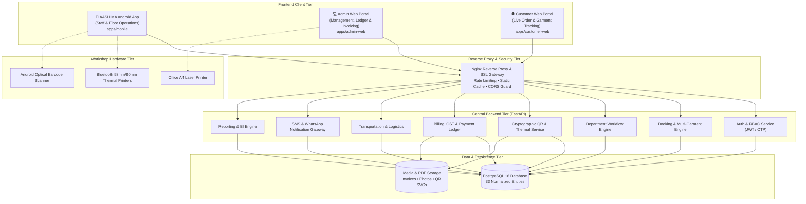
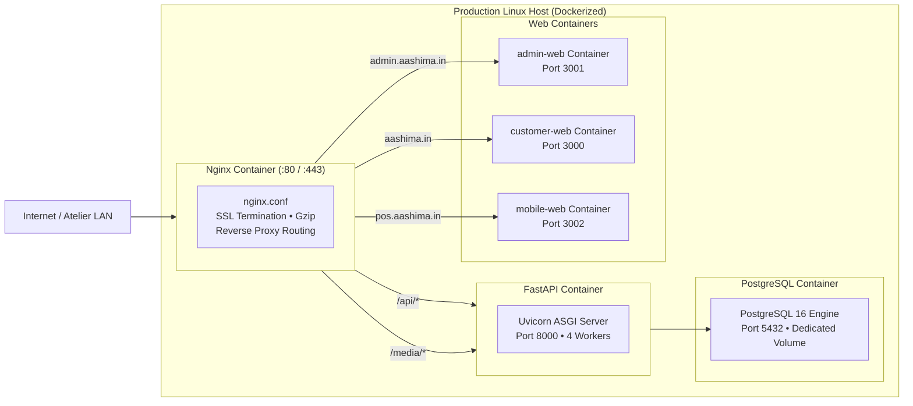

# AASHIMA ERP – System Architecture Documentation

**Business Entity**: AASHIMA Women's World & AASHIMA Stitchers 'N' Drapers  
**Location**: 581, Turab Nagar, Ghaziabad, Uttar Pradesh, 201001, India  
**Architecture Pattern**: Modular Monorepo with Centralized Micro-Kernel Backend  
**Version**: 2.4.0 (Enterprise Release)  

---

## 1. High-Level System Architecture

The AASHIMA ERP software ecosystem is architected as three independent client applications communicating with a single, highly performant, resilient central backend powered by **Python FastAPI** and a normalized **PostgreSQL** database.

---

## 2. Component Architecture & Responsibility Separation

### 2.1 Application 1: AASHIMA Android Application (`apps/mobile/`)
- **Target Users**: Owner, Store Managers, Master Tailors (Master Iqbal), Finishing Masters (Master Ramesh Chandra), Counter Operators.
- **Form Factor**: Android Handheld POS and Tablets (390dp to 800dp).
- **Core Responsibilities**:
  - Counter order intake with multi-garment support.
  - Granular 0.25" precision tailoring measurement matrix (Coat, Pant, Shirt, Kurta/Pajama, Lehenga/Blouse).
  - High-speed camera QR code barcode scanning.
  - Department workflow stage transitions with karigar assignment.
  - Optical proof capture (intake condition photos).
  - ESC/POS 58mm and 80mm Bluetooth receipt and tag generation.
  - Cash and UPI advance collection.

### 2.2 Application 2: AASHIMA Admin Web Portal (`apps/admin-web/`)
- **Target Users**: Business Owner (Aashima Singhal), Chief Accountant (Rohan Sharma), Operations Supervisor.
- **Form Factor**: Desktop and Workshop Terminal Displays (1440px+).
- **Core Responsibilities**:
  - Global overview dashboard with live daybook positions, pipeline piece counts, and urgent delivery alerts.
  - Interactive Karkhana Pipeline Kanban board across 6 workshop wings.
  - Complete customer registry ledger with lifetime spend and past dues tracking.
  - Master measurement book with historical baseline comparisons.
  - GST invoicing, HSN/SAC code management, CGST/SGST/IGST calculations, and official tax invoice PDF generation.
  - Batch thermal roll generation for 58mm, 80mm, and A4 sticker sheets.
  - Expense ledger and operational P&L auditing.

### 2.3 Application 3: AASHIMA Customer Website (`apps/customer-web/`)
- **Target Users**: Boutique Patrons and Bridal Wear Clients.
- **Form Factor**: Responsive Mobile, Tablet, and Desktop.
- **Core Responsibilities**:
  - Public order tracking via Booking # + Registered Phone + 6-digit OTP verification.
  - Direct QR link resolution via unpredictable tokens.
  - 5-stage live status timeline with pulsating active node.
  - Visual inspection proof photo review.
  - Itemized bill breakdown with download tax invoice link.
  - Instant one-click WhatsApp and telephone workshop assistance.
  - Post-delivery feedback and fitting rating submission.
  - **Security Guarantee**: Strict read-only isolation; zero access to internal administrative or stage update endpoints.

### 2.4 Central Backend Service (`backend/`)
- **Framework**: Python 3.10+ with FastAPI.
- **ORM & Migrations**: SQLAlchemy 2.0 with Alembic versioning.
- **Financial Precision**: Strict `Decimal` types (`Numeric(12, 2)`) for all financial amounts, tax calculations, and discount deductions. Never uses floating-point arithmetic.
- **Authentication**: JWT access tokens (HS256) with short expiry, long-lived refresh tokens, and SMS/WhatsApp OTP verification.
- **Security**: Role-Based Access Control (RBAC) protecting all administrative endpoints from customer and unauthorized staff access.

---

## 3. Deployment & Infrastructure Architecture

