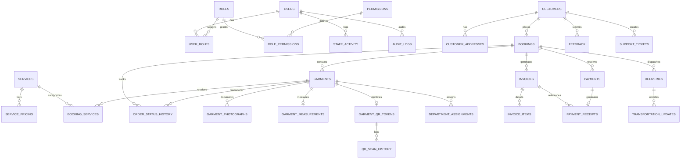

# AASHIMA ERP – Database Architecture & Data Dictionary

**Database Management System**: PostgreSQL 16 (Compatible with SQLite for test environments)  
**Schema Definition**: 37 Modeled Tables
**Financial Type Standard**: `NUMERIC(12, 2)` / `DECIMAL(10, 2)`  
**Audit Standard**: Created/Updated Timestamps, Soft-Deletions, User ID Traceability  

---

## 1. Entity-Relationship (ER) Diagram



---

## 2. Comprehensive Data Dictionary (All 37 Tables)

### Group 1: Authentication & Access Control
| Table Name | Primary Key | Key Foreign Keys | Purpose & Indices |
|---|---|---|---|
| `users` | `id` (INT) | None | System staff and owner accounts. Indexed on `username`, `phone`, `email`. |
| `roles` | `id` (INT) | None | System roles: Owner, Manager, Staff, Accountant, Delivery Staff, Customer. |
| `permissions` | `id` (INT) | None | Fine-grained operation permissions. Indexed on `code`. |
| `user_roles` | Composite | `user_id`, `role_id` | Join table mapping users to roles with cascade deletion. |
| `role_permissions` | Composite | `role_id`, `permission_id` | Join table mapping roles to permissions. |
| `staff_activity` | `id` (INT) | `user_id` | Real-time audit log of staff floor actions (stage transitions, collections). |
| `audit_logs` | `id` (INT) | `user_id` | Detailed snapshot of record changes with JSON `old_values` and `new_values`. |

### Group 2: Customer Registry & Patron Loyalty
| Table Name | Primary Key | Key Foreign Keys | Purpose & Indices |
|---|---|---|---|
| `customers` | `id` (INT) | None | Client dossiers with patron tier, lifetime spend, and OTP authentication fields. |
| `customer_addresses`| `id` (INT) | `customer_id` | Multi-address support (Home, Boutique, Studio) with default flag. |
| `feedback` | `id` (INT) | `customer_id`, `booking_id` | Post-service client ratings (1-5 stars) and fitting notes. |
| `support_tickets` | `id` (INT) | `customer_id`, `booking_id` | Inquiries regarding delays, alter requests, or billing queries. |

### Group 3: Services & Tailoring Measurement Templates
| Table Name | Primary Key | Key Foreign Keys | Purpose & Indices |
|---|---|---|---|
| `services` | `id` (INT) | None | Service catalog (Alteration, Deep Cleaning, Finishing, Tailoring). |
| `service_pricing` | `id` (INT) | `service_id` | Pricing tiers based on fabric types (Silk, Velvet) and GST rates (5%, 18%). |
| `tailoring_measurement_templates` | `id` (INT) | None | Master blueprints for Coat, Pant, Shirt, Kurta, Lehenga, Blouse with 0.25" steps. |

### Group 4: Bookings, Garments & Artisan Floor Workflow
| Table Name | Primary Key | Key Foreign Keys | Purpose & Indices |
|---|---|---|---|
| `bookings` | `id` (INT) | `customer_id`, `created_by_user_id` | Master order voucher (#ASH-XXXX), division, total amount, balance, status. |
| `garments` | `id` (INT) | `booking_id`, `karigar_user_id` | Individual article tracking (#ASH-XXXX-G01), fabric, color, rack location. |
| `garment_photographs` | `id` (INT) | `garment_id`, `uploaded_by_user_id` | Intake macro snapshots and defect documentation photos. |
| `garment_measurements` | `id` (INT) | `garment_id` | JSON measurement matrix linked to article with karigar directives. |
| `booking_services` | `id` (INT) | `garment_id`, `service_id` | Itemized services attached to each garment with individual GST amounts. |
| `department_assignments` | `id` (INT) | `garment_id`, `assigned_karigar_id` | Work orders allocated to alteration tailors, steam pressers, or dyers. |
| `workflow_stage_configs` | `id` (INT) | None | Configurable stage transitions and mandatory sequence rules. |
| `order_status_history` | `id` (INT) | `booking_id`, `garment_id`, `changed_by_user_id` | Immutable audit trail of every status change with timestamp and remarks. |

### Group 5: Cryptographic QR Code System
| Table Name | Primary Key | Key Foreign Keys | Purpose & Indices |
|---|---|---|---|
| `garment_qr_tokens` | `id` (INT) | `garment_id`, `last_printed_by_user_id` | Cryptographic HMAC-signed unpredictable tokens and print counters. |
| `qr_scan_history` | `id` (INT) | `qr_token_id`, `garment_id`, `scanned_by_user_id` | Log of every optical barcode scan across floor stations and mobile devices. |

### Group 6: Billing, Invoicing & Financial Daybook
| Table Name | Primary Key | Key Foreign Keys | Purpose & Indices |
|---|---|---|---|
| `gst_configurations` | `id` (INT) | None | Shop legal credentials (GSTIN 09AABCA1234F1Z8, State Code 09 UP). |
| `invoices` | `id` (INT) | `booking_id`, `customer_id`, `generated_by_user_id` | Official GST & Non-GST tax invoices (#ASH-INV-YYYY-XXXX). |
| `invoice_items` | `id` (INT) | `invoice_id`, `garment_id` | Itemized invoice lines with HSN/SAC codes, CGST, SGST, taxable values. |
| `payments` | `id` (INT) | `booking_id`, `customer_id`, `collected_by_user_id` | Financial ledger entries for Cash, UPI, and Card transactions. |
| `payment_receipts` | `id` (INT) | `payment_id`, `invoice_id` | Official receipts with remaining balance tracking (#REC-YYYY-XXXX). |
| `expenses` | `id` (INT) | `approved_by_user_id` | Operational workshop expenses (threads, chemicals, utility, karigar advances). |

### Group 7: Transportation, Notifications & Business Settings
| Table Name | Primary Key | Key Foreign Keys | Purpose & Indices |
|---|---|---|---|
| `deliveries` | `id` (INT) | `booking_id`, `delivery_staff_id` | Store pickup staging or courier / chauffeur home dispatch. |
| `transportation_updates` | `id` (INT) | `delivery_id`, `reported_by_user_id` | Milestone updates (Dispatched from Turab Nagar, Out for Delivery, Handed Over). |
| `notification_templates` | `id` (INT) | None | Pre-approved SMS and WhatsApp notification templates with variables. |
| `notification_logs` | `id` (INT) | `customer_id`, `booking_id` | Audit trail of sent messages, delivery status, and retry counters. |
| `business_settings` | `id` (INT) | None | Dynamic key-value store for workshop preferences and hardware configs. |

---

## 3. Database Indexes & Constraints Architecture

To guarantee sub-10ms query execution across active counter operations:

1. **Unique Natural Identifiers**:
   - `users.username`, `users.phone`
   - `customers.customer_code`, `customers.phone`
   - `bookings.booking_number`
   - `garments.garment_code`
   - `garment_qr_tokens.qr_code_identifier`, `garment_qr_tokens.secure_token`
   - `invoices.invoice_number`
   - `payments.payment_reference`

2. **Foreign Key Performance Indexes**:
   - Index on `garments(booking_id)`
   - Index on `booking_services(garment_id)`
   - Index on `order_status_history(booking_id, garment_id)`
   - Index on `payments(booking_id)`
   - Index on `invoice_items(invoice_id)`
   - Index on `customer_addresses(customer_id)`

3. **Composite Operational Filter Indexes**:
   - `bookings(division, current_status, is_urgent)`
   - `garments(current_stage, rack_location)`
   - `payments(created_at, payment_mode)`
   - `audit_logs(table_name, record_id)`

---

## 4. Migration & Schema Maintenance Guide

Alembic manages schema evolution without downtime:

```bash
# Generate new migration when models change
py -m alembic -c backend/alembic.ini revision --autogenerate -m "describe_change"

# Apply pending migrations to production
py -m alembic -c backend/alembic.ini upgrade head

# Rollback last migration
py -m alembic -c backend/alembic.ini downgrade -1
```
