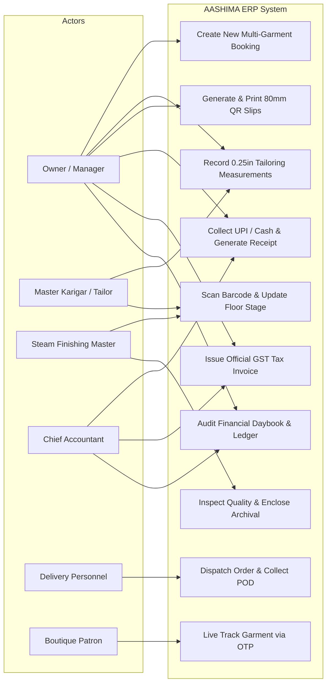
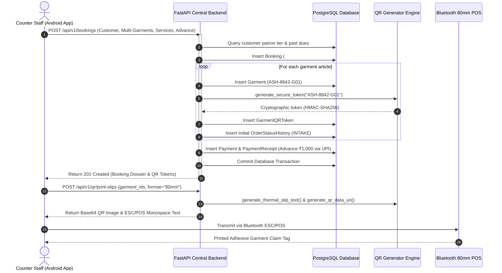
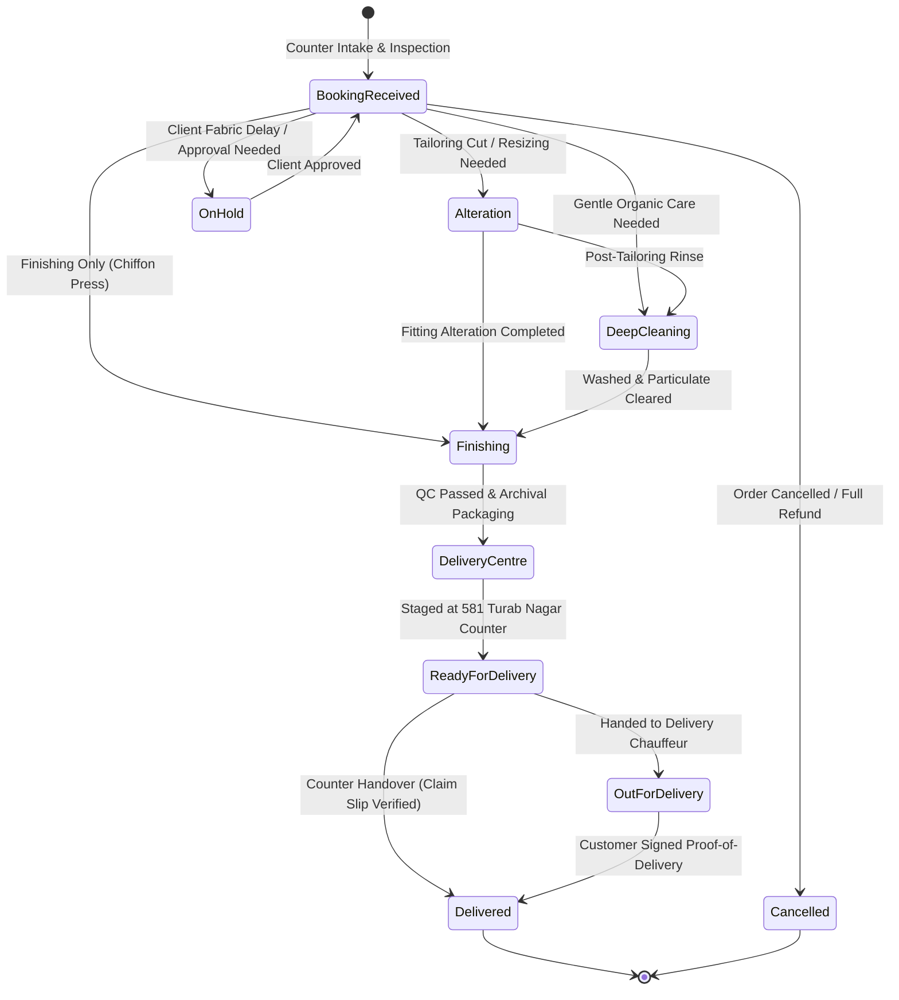
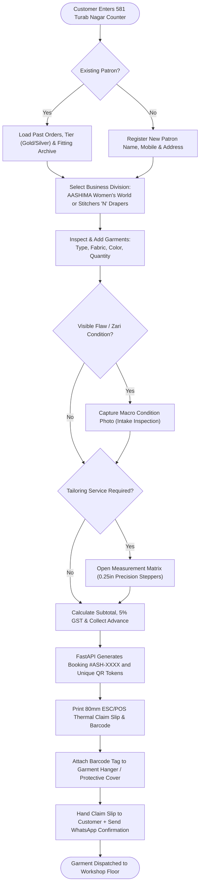
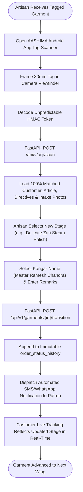
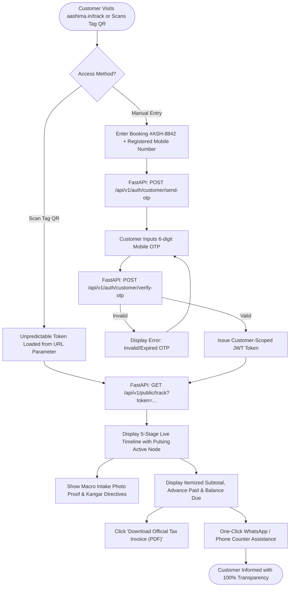

# AASHIMA ERP – UML & Business Process Flow Diagrams

**Business**: AASHIMA Women's World & AASHIMA Stitchers 'N' Drapers (581, Turab Nagar, Ghaziabad)  
**Standard**: UML 2.5 & BPMN 2.0 Representation in Mermaid  

---

## 1. Unified Modeling Language (UML) Diagrams

### 1.1 Use Case Diagram

### 1.2 Sequence Diagram: New Multi-Garment Booking with QR Generation

### 1.3 State Machine Diagram: Garment Lifecycle

---

## 2. Business Process Flow Diagrams

### 2.1 Customer Booking & Garment Tagging Process

### 2.2 QR Scanning & Floor Stage Update Process

### 2.3 Public Customer Tracking Flow (OTP Verified)

